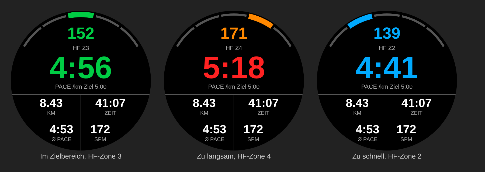

# Läufer-Cockpit: Connect-IQ-Datenfeld für Garmin

Ein Vollbild-Datenfeld für die Lauf-App der Uhr. Alles Wichtige auf einer Seite:

*Nachbau des Layouts mit Beispielwerten, kein Simulator-Screenshot.*

| Bereich | Inhalt |
|---|---|
| Bogen oben | Herzfrequenzzone 1–5, Zonen kommen aus dem Garmin-Benutzerprofil (Laufen) |
| Oben | Aktuelle Herzfrequenz in Zonenfarbe |
| Mitte, groß | Aktuelle Pace, über 10 s geglättet. Grün = im Ziel, Rot = zu langsam, Blau = zu schnell |
| Unten | Distanz, Zeit, Ø-Pace, Kadenz (Schritte/min) |

Ist das Feld auf einer Seite mit mehreren Feldern, zeigt es nur die Pace.
km/mi richten sich nach den Einheiten der Uhr.

## Einstellungen (Connect-IQ-App am Handy)

- **Zielpace**: `m:ss`, z. B. `5:00`. `0:00` schaltet die Farbsteuerung aus.
- **Toleranz**: Sekunden um die Zielpace, die noch als „im Ziel“ gelten (Standard 10).

## Bauen und aufs Gerät bringen

1. [Connect IQ SDK](https://developer.garmin.com/connect-iq/sdk/) und die VS-Code-Erweiterung „Monkey C“ installieren, Developer Key erzeugen (`Monkey C: Generate a Developer Key`).
2. Ordner `garmin-laeufer` in VS Code öffnen.
3. Testen: `Monkey C: Run` startet den Simulator. Unter *Simulation → Activity Data* lässt sich ein Lauf abspielen.
4. Aufs Gerät: `Monkey C: Build for Device` und das Gerät wählen. Die erzeugte `.prg` per USB nach `GARMIN/APPS/` kopieren.
5. Auf der Uhr: Laufen → Einstellungen → Datenseiten → Seite mit **1 Feld** anlegen → Connect IQ → *Läufer-Cockpit*.

Weitere Uhren lassen sich in `manifest.xml` ergänzen (VS Code: `Monkey C: Edit Products`).

## Aufbau

- `source/LaeuferApp.mc`: App-Einstieg, lädt die Einstellungen neu.
- `source/LaeuferView.mc`: Berechnung (`compute`, 1×/s) und Zeichnen (`onUpdate`).
- `resources/settings/`: Zielpace und Toleranz.
